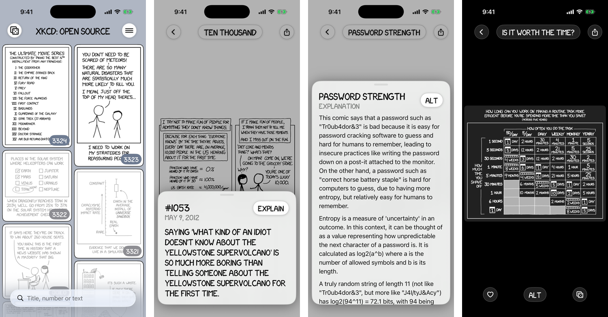

 

## A free, ad-free, open-source, native, and universal xkcd.com reader for iOS. [Download it from the App Store!](https://apps.apple.com/app/id6833707708)

This is a revival of Mike Amaral's [xkcd: Open Source](https://github.com/mamaral/xkcd-Open-Source), which was my favorite xkcd reader for years until it was abandoned and pulled from the App Store. It's a from-scratch rewrite in SwiftUI that keeps the mosaic, the lettering and the feel of the original.

## Architecture

- SwiftUI for everything, no third-party libraries.
- Comics come straight from xkcd.com's JSON API, so there's no server to keep alive. A bundled seed of every comic's size makes the first launch fast.
- A tiny Core ML model, trained only on xkcd's own 1x/2x image pairs, sharpens small comics on the device. It runs in tiles on the Neural Engine, falling back to the GPU and then a hand-written filter.
- Dark mode redraws each comic light-on-dark, with per-comic overrides where the rules get it wrong.
- WidgetKit for the latest-comic and random-comic widgets.
- BackgroundTasks for new-comic alerts.
- iCloud key-value storage to sync favorites and read comics.
- [xkcd-font](https://github.com/ipython/xkcd-font) because obviously.
- Explanations from [explain xkcd](https://www.explainxkcd.com) when you ask for one.

## Version History

- **v1.0**
   - Every comic in a mosaic, with search by title, number or text
   - Swipe between comics, pinch and double-tap to zoom, drag down to go back to the grid
   - Alt text and the explain xkcd explanation in a panel that slides up
   - Roll the dice for a random comic
   - Favorites and an unread filter
   - Interactive comics play in the app
   - On-device sharpening of small comics
   - Dark mode with redrawn comics
   - Home Screen widgets, including a random comic picked to fit the widget's shape
   - New-comic alerts
   - iCloud sync
   - iPhone, iPad, and Apple silicon Macs

## Building

Open `XKCDReader.xcodeproj` in Xcode 26 or later. The app targets iOS 18. Set your own team, and change the bundle IDs (`app.xkcdrevival.reader`, `app.xkcdrevival.reader.widgets`) and the app group (`group.app.xkcdrevival.reader`) to ones you own. `scripts/run_checks.sh` runs the command-line checks.

Debug and Simulator builds have a Debug Mode switch in the Settings app with a few testing tools. App Store builds leave it out.

## Contributors

- [Shane Ryan](https://github.com/sryan-pub) - The revival.
- [Mike Amaral](https://github.com/mamaral) - The original app this is based on.

## Want to help?

Use the app and send feedback! Leave a star on the repo and a review on the App Store. If you find a bug, have a feature request, or just want to say hi, [open an issue](https://github.com/sryan-pub/xkcd-os/issues/new). Pull requests are welcome too.

## License / Attribution

The source is made available under the MIT license. See [LICENSE](LICENSE) for details.

xkcd comics are by Randall Munroe and shared under [Creative Commons Attribution-NonCommercial 2.5](https://xkcd.com/license.html). The hand-drawn font is from [ipython/xkcd-font](https://github.com/ipython/xkcd-font) under Creative Commons Attribution-NonCommercial 3.0. Explanations are written by the contributors to [explain xkcd](https://www.explainxkcd.com) under [Creative Commons Attribution-ShareAlike 3.0](https://creativecommons.org/licenses/by-sa/3.0/). The Classic icon comes from the original app under its MIT license. Because of those non-commercial licenses, anything built from this has to stay free. More detail in [CREDITS.md](CREDITS.md).

This app is not affiliated with xkcd or Randall Munroe.
